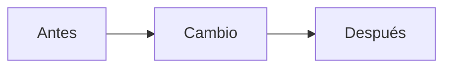

# SDD Flow

Este proyecto sigue Spec-Driven Development. Sigue este ciclo completo,
en orden, sin saltarte etapas.

## Activación (solo con prefijo explícito)

Esta skill NO se activa por palabras sueltas en el mensaje. Se activa
únicamente si el mensaje empieza con uno de estos siete prefijos:

- `SDD-agregar: [descripción]` → funcionalidad nueva
- `SDD-bug: [descripción]` → corrección de un bug
- `SDD-refactor: [descripción]` → refactor sin cambiar comportamiento
- `SDD-migracion: [descripción]` → cambio de esquema o migración de datos
- `SDD-optimizacion: [descripción]` → mejora de rendimiento sin cambiar comportamiento
- `SDD-tests: [descripción]` → agregar cobertura de tests a código sin tests
- `SDD-investigacion: [descripción]` → spike/investigación técnica, sin comprometerse a implementar

Si el mensaje no trae uno de estos prefijos, aunque mencione palabras
como "agregar", "arreglar", "migrar" u "optimizar", **no actives este
flujo** — responde de forma normal, como cualquier otro pedido.

Ejemplos:

```
SDD-agregar: quiero un endpoint que marque varias tareas como
completadas a la vez.
```
```
SDD-bug: cuando envío una fecha en DD/MM/YYYY el sistema la guarda
mal. Debería aceptar solo YYYY-MM-DD.
```
```
SDD-refactor: la función procesar_pedido() tiene 150 líneas y mezcla
tres responsabilidades. Quiero simplificarla sin cambiar cómo
funciona hacia afuera.
```
```
SDD-migracion: necesito convertir los INSERT de conceptos_tipo_novedads
a UPDATE, preservando los IDs existentes.
```
```
SDD-optimizacion: el endpoint GET /reportes tarda 8 segundos con
10,000 registros, necesito bajarlo a menos de 1 segundo.
```
```
SDD-tests: el módulo calcular_nomina.py no tiene ningún test y es
crítico, necesito cobertura antes de tocarlo.
```
```
SDD-investigacion: necesito decidir si usar LangGraph o hacer tool
calling manual para el agente SQL, antes de comprometerme a implementar.
```

Mensajes sin el prefijo, como "agrégale un botón de guardar" o "arregla
este error", se tratan como pedidos normales de código — no disparan
spec, ni plan, ni las 11 etapas.

## Prohibiciones y permisos explícitos (aplican SIEMPRE)

Estas reglas no se suspenden aunque el plan ya esté aprobado, aunque
el usuario tenga prisa, ni aunque parezcan "un detalle menor" dentro
de una etapa aprobada. Si alguna bloquea seguir, detente y pregunta
explícitamente — no la saltees ni la reinterpretes.

1. **Nunca ejecutes SQL que modifique datos** (INSERT, UPDATE, DELETE,
   DROP, ALTER, TRUNCATE) contra una base de datos que no sea de
   prueba/local, sin confirmación explícita del usuario en ese momento
   — aunque sea un `SDD-migracion` con plan ya aprobado. Antes de
   ejecutar, confirma en voz alta contra qué base/conexión vas a correr
   el comando (nombre de la BD, host, si es producción o no).
2. **Nunca hagas `git commit`, `git push`, `git reset --hard`, ni
   ninguna operación que modifique el historial de git**, sin que el
   usuario lo pida explícitamente en ese mensaje. Sugerir el comando
   (como texto para que el usuario lo corra) no es lo mismo que
   ejecutarlo tú.
3. **Nunca elimines archivos o carpetas** fuera de lo explícitamente
   aprobado en el plan de la Etapa 4.
4. **Nunca instales o actualices paquetes/dependencias** que no estén
   en el plan aprobado, sin avisar primero — aunque sea "solo una
   dependencia chica".
5. **Nunca leas, muestres o loguees contenido de archivos de
   credenciales** (`.env`, secrets, connection strings con contraseña)
   salvo que sea estrictamente necesario para la tarea y el usuario lo
   apruebe explícitamente para ese caso puntual.
6. **Nunca ejecutes migraciones o scripts contra datos reales/producción**
   sin que el usuario haya confirmado explícitamente que es el entorno
   correcto — el plan de rollback de la spec (Etapa 2/Plantilla
   SDD-migracion) no reemplaza esta confirmación puntual.

## Etapa 0 — Continuidad con proyectos anteriores

Antes de empezar, busca si existe algún `docs/CHECKLIST-PROYECTO-*.md` o
`docs/CIERRE-PROYECTO-*.md` de un proyecto anterior en este repo o en
repos hermanos referenciados. Si existe:

- Lee la sección "Aprendizajes de este proyecto" del cierre anterior
- Menciona brevemente al usuario qué aprendizajes previos vas a tener en
  cuenta
- No repitas errores o simplificaciones ya identificadas como "hacer
  distinto la próxima vez" en el cierre anterior

Si no existe ninguno (primer proyecto), sigue normalmente desde la Etapa 1.

## Etapa 1 — Spec

El prefijo ya te dice qué tipo de trabajo es y qué plantilla usar
(ver todas las plantillas al final de este documento):

- `SDD-agregar` → SPEC (Feature)
- `SDD-bug` → SPEC-BUGFIX
- `SDD-refactor` → SPEC-REFACTOR
- `SDD-migracion` → SPEC-MIGRACION
- `SDD-optimizacion` → SPEC-OPTIMIZACION
- `SDD-tests` → SPEC-TESTS
- `SDD-investigacion` → SPEC-INVESTIGACION

**En todos los casos, siempre se escribe una spec antes de tocar código
(o antes de investigar, en el caso de SDD-investigacion).** Lo que
cambia es su tamaño y contenido, no si existe o no.

Si tienes dudas sobre cuál tipo es, pregunta al usuario antes de asumir.

Lee la spec en `docs/specs/`. Si no existe, créala con la plantilla que
corresponda y espera aprobación explícita del usuario antes de seguir.

**Regla de título (obligatoria, sin excepción):** el título (`#`) de todo
archivo de spec SIEMPRE es un comando `SDD-<tipo>: <pedido>`, nunca un
nombre inventado. El número (`SPEC-XXX`, `SPEC-BUGFIX-XXX`, etc.) va en el
nombre del archivo, no en el título.
- Si el usuario escribió el prefijo, el título es su mensaje tal cual, sin
  editar.
- Si pidió la spec de otra forma (sin prefijo, en varios mensajes, o con
  "haz una spec de..."), construye el título eligiendo el prefijo correcto
  según el tipo de trabajo y resumiendo el pedido real en una sola línea.
  Nunca dejes el placeholder ni uses un nombre genérico.
- El título sirve como comando exacto para re-disparar o retomar esa spec
  después, así que debe quedar completo y accionable, no un fragmento.

Ej. con prefijo literal: `# SDD-agregar: quiero agregar un endpoint que
permita marcar varias tareas como completadas a la vez`.

Antes de darla por completa, verifica:
- [ ] Cada acceptance criterion se puede convertir en un test de sí/no
      (o, para SDD-investigacion, en una pregunta respondida sí/no)
- [ ] No hay criterios ambiguos ("debe funcionar bien", "debe ser rápido")
- [ ] El "fuera de alcance" está explícito, no implícito

## Etapa 2 — Arquitectura (obligatoria antes del plan)

Para features nuevas y migraciones, esto es un paso completo. Para
bugfix, tests u optimización pequeña, puede ser una sola línea
("no cambia la arquitectura, solo la implementación interna de X")
— pero se declara siempre, no se omite en silencio.

Para `SDD-investigacion`, esta etapa se reemplaza por: "qué opciones
se van a comparar y con qué criterio" (ver plantilla).

No pases a proponer un plan sin antes definir la arquitectura explícita:

- Dibuja o describe el flujo técnico en 3-4 pasos como máximo
  (ej: "FastAPI → Service → SQLite")
- Si se necesitan más de 4 cajas para algo simple, es señal de
  sobreingeniería temprana — dilo antes de seguir, no lo calles
- Distingue qué tecnología ya es conocida vs. qué es nueva, y adviértelo
  al usuario si hay algo nuevo que requiere aprendizaje adicional
- Antes de diseñar, corre `/ponytail-audit` sobre el módulo/carpeta que
  vas a tocar — para **cualquier** tipo de trabajo, no solo
  refactor/migración. Te dice cuánta complejidad ya existe ahí antes de
  sumar código nuevo encima. Si no está disponible, sigue sin él, no
  bloquea la etapa.
- Para `SDD-migracion`: incluye explícitamente el plan de rollback
  (cómo revertir si algo sale mal) como parte de la arquitectura
- Para `SDD-optimizacion`: incluye cómo se va a medir el "antes" (baseline)
  antes de proponer el plan

**NO escribas código todavía.**

## Etapa 3 — Plan

1. Analiza el repositorio existente y busca código relacionado que ya exista
2. Detecta ambigüedades en la spec y pregunta antes de asumir
3. Propón un plan de implementación paso a paso, basado en la arquitectura
   ya definida en la Etapa 2

Para `SDD-investigacion`: el "plan" es el método de investigación
(qué se va a probar, en qué orden, cómo se compara), no un plan de
implementación de código productivo.

**NO escribas código todavía.** Espera aprobación explícita del plan.

## Etapa 4 — Aprobación

Espera confirmación explícita del usuario. No la asumas por silencio ni
por mensajes ambiguos tipo "ok" sin contexto — si hay duda, pregunta
"¿apruebas este plan tal cual, o quieres ajustar algo antes?".

## Etapa 5 — Implementación

- Implementa SOLO lo aprobado.
- Escribe un test por cada acceptance criterion de la spec (excepto en
  `SDD-investigacion`, donde el entregable es un documento de hallazgos
  y recomendación, no código productivo).
- No agregues abstracciones, capas o funcionalidades que la spec no pida.
- Para `SDD-migracion`: implementa primero en modo "dry-run" o sobre
  una copia de los datos si es posible, antes de aplicar sobre datos reales.
- Para `SDD-tests`: NO modifiques el código de producción en esta etapa,
  solo agrega tests que documenten el comportamiento actual (aunque ese
  comportamiento tenga bugs conocidos — eso se resuelve con un `SDD-bug`
  aparte, no mezclado aquí).

### Principios SOLID (guía de diseño, no checklist burocrático)

Al escribir o tocar clases/funciones en esta etapa, estos 5 principios
evitan el tipo de deuda que un refactor tiene que deshacer después.
Aplícalos con criterio — son una guía para decidir, no una lista de
casillas a marcar por archivo:

- **S — Responsabilidad única**: si una clase/función cambia por más de
  una razón de negocio distinta, está mezclando responsabilidades. Señal
  de alarma: un método que valida, calcula y persiste en el mismo bloque.
- **O — Abierto/cerrado**: agregar un caso nuevo (un tipo de regla, un
  estado nuevo) no debería obligar a reescribir un `if/elif` gigante ya
  existente en cada lugar que lo usa — pero no inventes una jerarquía de
  clases "por si acaso". Aplica esto solo cuando la spec ya trae un
  segundo caso real, no uno hipotético (ver YAGNI de ponytail).
- **L — Sustitución de Liskov**: si una función acepta un tipo base (o una
  interfaz implícita en Python — un objeto con ciertos métodos),
  cualquier implementación debe poder usarse sin romper al llamador.
  Señal de alarma: un `isinstance()` o `if tipo == X` dentro de una
  función que debería tratar a todas sus entradas igual.
- **I — Segregación de interfaces**: no fuerces a un caller a depender de
  métodos que no usa. Señal de alarma: una clase con muchos métodos
  públicos donde cada caller solo usa dos o tres — partirla por uso real,
  no por anticipación.
- **D — Inversión de dependencias**: el código de negocio (service) no
  debería depender directamente de detalles de infraestructura (una
  librería HTTP concreta, el motor de BD exacto), sino de una abstracción
  que el detalle implementa — en este repo, el patrón Service → Provider
  ya cumple esto: el service no arma SQL ni sabe qué motor hay debajo.

**Cuándo priorizarlos sobre el guardrail de alcance:** si aplicar SOLID
implicaría tocar algo fuera del plan aprobado (ej. partir una clase ya
existente que no está en el alcance), no lo hagas en silencio — repórtalo
como hallazgo para la Etapa 8 (`/code-review` o `/ponytail-review`), no lo
mezcles con la implementación de esta etapa.

**No es un passthrough para sobreingeniería:** Abierto/Cerrado y
Segregación de interfaces son los dos que más fácil se usan para
justificar abstracciones que la spec no pidió. Si ponytail
(`/ponytail-review`) y SOLID chocan en una decisión puntual, gana ponytail
salvo que haya un segundo caso real y actual (no hipotético) que SOLID
resuelve y YAGNI no.

### Guardrail de alcance (obligatorio)

Si durante la implementación descubres que hace falta tocar algo que
el plan aprobado NO mencionaba (un archivo nuevo, una dependencia nueva,
un cambio de estructura), **detente y pregunta antes de continuar** —
no lo trates como "un detalle menor" ni sigas adelante asumiendo que
está bien.

## Etapa 6 — Tests

Antes de dar los tests por completos, compara:
- [ ] Cantidad de tests ≥ cantidad de acceptance criteria de la spec
- [ ] Cada test se puede rastrear a un criterio específico
- [ ] Se cubren también los casos de error, no solo el camino feliz

Para `SDD-optimizacion`: además de los tests funcionales (que confirman
que el comportamiento no cambió), incluye la medición de rendimiento
antes/después (benchmark).

Para `SDD-migracion`: incluye tests de integridad de datos (conteos,
checksums, o comparación de muestras antes/después).

Para `SDD-investigacion`: esta etapa no aplica — no hay tests, hay
un documento de hallazgos (ver Etapa 9 adaptada).

Si la cantidad de tests es menor a la de acceptance criteria, dilo
explícitamente antes de seguir — no lo dejes pasar en silencio.

## Etapa 7 — Verificación (automática, sin que se te pida)

1. Corre los tests tú mismo.
2. Si algo falla, corrige el código (o el test, si el test estaba mal
   planteado) y vuelve a correr — repite hasta que todo pase.
3. Al terminar, da un resumen breve de: qué falló, qué corregiste,
   y confirmación de que todos los acceptance criteria pasan, uno por uno.
4. Si para hacer pasar un test tuviste que cambiar el comportamiento
   esperado (no solo el código), dilo explícitamente — no lo trates
   como "corrección menor".

Para `SDD-optimizacion`: reporta la métrica medida (antes vs. después)
como parte del resumen — no solo "los tests pasan".

Esta etapa se da por completa en cuanto los tests automáticos pasan.
No esperes confirmación del usuario aquí — sigue normalmente a la
Etapa 8. Las pruebas manuales se generan al final, como último paso,
para que el usuario las haga con calma sin que el resto del flujo
quede esperando (ver "Pruebas manuales" al final de este documento).

## Etapa 8 — Revisión (Ponytail + correctitud)

Dos revisiones con propósitos distintos — ninguna reemplaza a la otra:
- **Ponytail** (`/ponytail-review`, `/ponytail-audit`, etc.) busca
  sobreingeniería: código de más, abstracciones sin segundo uso,
  dependencias sin usar. **Nunca busca bugs, por diseño** (está fuera
  de su alcance explícitamente).
- **`/code-review`** busca bugs de correctitud — concurrencia, lógica
  de negocio, casos borde. **Nunca busca sobreingeniería.**

Corre ambas, en este orden (ponytail primero, código más simple es más
fácil de revisar por bugs después). El comando (o los comandos) exacto
depende del tipo de trabajo:

### SDD-agregar (feature)
```
/ponytail-review
/code-review medium
```

### SDD-bug (bugfix)
Revisa el parche y registra si el bug viene de deuda técnica existente:
```
/ponytail-review
/ponytail-debt
/code-review medium
```

### SDD-refactor (refactor)
Secuencia completa: dimensionar antes, confirmar después, medir al cierre.
```
/ponytail-audit       (antes de implementar, en Etapa 2/3)
/ponytail-review      (después de implementar)
/ponytail-gain        (al cerrar, evidencia medible)
/code-review medium   (después de implementar: que el comportamiento
                        externo siga IDÉNTICO, no solo que los tests
                        existentes pasen)
```

### SDD-migracion
Igual que refactor: el código de migración también puede sobre-diseñarse.
```
/ponytail-audit       (antes, sobre el script/módulo de migración)
/ponytail-review      (después de implementar)
/code-review high     (los bugs de migración de datos salen caros —
                        usa el nivel alto, no medium)
```

### SDD-optimizacion
```
/ponytail-review      (que la optimización no metió complejidad de más)
/ponytail-gain        (evidencia medible del rendimiento, no solo del código)
/code-review medium   (que la optimización no cambió el resultado, solo la velocidad)
```

### SDD-tests
```
/ponytail-review      (que los tests nuevos no dupliquen lógica entre sí)
```

### SDD-investigacion
No aplica revisión de código (no hay código productivo). Si el spike
generó código exploratorio desechable, dilo explícitamente y confirma
que no se mezcla con el repo principal.

### Si el plugin no está instalado (fallback manual, cualquier tipo)
```
¿Hay abstracciones que la spec no pedía?
¿Hay código duplicado?
¿Hay dependencias que no se usan?
¿Se implementó algo fuera del alcance de la spec?
```

### Log obligatorio de cada corrida de ponytail

La salida de `/ponytail-review`, `/ponytail-audit`, `/ponytail-debt` y
`/ponytail-gain` viene en formato comprimido
(`archivo:línea: tipo: descripción / sugerencia / net:`).
Ese formato es intencional (Ponytail aplica su propia filosofía de "menos
texto" a su propio output) — no lo dejes tal cual para el usuario.

Por cada corrida de cualquiera de estos comandos, genera un archivo en
`docs/logs/ponytail-<comando>-<fecha>.log` con esta estructura, en español:

```
LOG DE PONYTAIL — [comando ejecutado] — [fecha]
==================================================

SALIDA ORIGINAL (formato comprimido)
--------------------------------------------------
[pega aquí la salida cruda tal cual]

EXPLICACIÓN TÉCNICA
--------------------------------------------------
Por cada hallazgo:
- Qué había antes (código/decisión actual)
- Qué problema detectó y por qué importa
- Qué se propone en su lugar, explicado paso a paso
- Ventaja del cambio (qué se simplifica/ahorra)
- Riesgo o trade-off, si lo hay

ACCIÓN CONCRETA
--------------------------------------------------
[el comando o cambio exacto para aplicar la sugerencia]

CIERRE
--------------------------------------------------
[ ] Hallazgo entendido
[ ] Cambio aplicado
[ ] Tests siguen pasando después del cambio
```

No omitas este log aunque el hallazgo parezca trivial, o aunque la
respuesta sea del tipo "Lean already. Ship." (en ese caso, el log solo
confirma que no hubo hallazgos nuevos).

### Log de `/code-review`

`/code-review` reporta con su propio formato (`ReportFindings`), no el
formato comprimido de ponytail — no hace falta traducirlo. Guarda la
salida tal cual en `docs/logs/code-review-<fecha>.log`. Si encontró
algo, aplícalo (o corre `/code-review --fix`) y vuelve a correr los
tests (Etapa 7) antes de seguir a la Etapa 9 — un hallazgo de
`/code-review` es un bug real, no una sugerencia de estilo.

## Etapa 9 — Documentación

Al cerrar, genera o actualiza `README.md` con:

- Qué hace el proyecto (2-3 líneas, sin jerga)
- Cómo instalarlo y correrlo (comandos exactos, copiables)
- Arquitectura (la definida en la Etapa 2)
- Cómo correr los tests
- Limitaciones conocidas (qué NO hace, qué quedó fuera de alcance)
- Referencia a la spec (`docs/specs/SPEC-XXX.md`)

### Swagger / documentación de rutas (si el trabajo agrega o modifica endpoints HTTP)

Cada endpoint nuevo o modificado debe quedar documentado en el propio
código para que Swagger (`/docs`) lo muestre completo — la idea es
poder entregárselo "masticado" a quien consuma la API (mobile/frontend),
sin que tengan que leer el código ni preguntarte qué significa cada
campo:
- `summary` y `description` en el decorador de la ruta: qué hace,
  cuándo devuelve error, qué regla de negocio aplica.
- `responses={...}` con los códigos de error relevantes, explicados.
- Cada campo de los schemas Pydantic de entrada/salida con
  `Field(description=...)`. **Nunca** un `Dict[str, Any]` (u objeto
  igual de opaco) para una respuesta con forma conocida — si de verdad
  es dinámico (ej. un mapa `{id_local: id_real}`), documéntalo en la
  descripción de la ruta, ya que el schema no puede.

Antes de dar por cerrada esta etapa, revisa `app.openapi()` (o abre
`/docs`) y confirma que ningún endpoint tocado en este trabajo tiene un
schema de respuesta opaco (`additionalProperties: true` sin ningún
campo declarado) — si lo tiene, no está listo para entregarle a otro
equipo, aunque los tests pasen.

Para `SDD-investigacion`: en vez de README, genera un documento de
hallazgos en `docs/investigaciones/INVESTIGACION-XXX.md` con: pregunta
original, opciones comparadas, criterio usado, hallazgos, y
recomendación final.

Prueba de fuego antes de darlo por terminado: alguien que no vio el
proceso debería entender el resultado solo leyendo el documento, sin
preguntar nada más.

### Entrega al front (si el trabajo cambia un contrato que consume el front o mobile)

Al terminar una spec que agrega o cambia endpoints HTTP, campos de
request/response, códigos de error o una regla de negocio que se ve en
pantalla, genera además un documento de contrato listo para entregar al
equipo de front/mobile. Swagger describe cada endpoint por separado; esta
entrega explica la feature completa y qué tiene que hacer la pantalla.
Aplica a `SDD-agregar`, y a `SDD-bug` / `SDD-refactor` solo si cambia lo que
el front envía o recibe. Si no hay contrato nuevo, no se genera (dilo en una
línea en el cierre, no lo omitas en silencio). No esperes aprobación para
generarlo, pero el usuario lo revisa antes de compartirlo.

**Formato:** una página publicada con la herramienta Artifact (privada por
defecto: avisa al usuario que debe compartirla desde el menú Share para que
el front pueda abrirla). Si el usuario prefiere un archivo, un `.md` en
`prs/ENTREGA-FRONT-<slug>.md`. Se escribe para quien no vio la conversación y
no usa nombres de funciones internas.

**Contenido mínimo (en este orden):**
1. Qué cambia y qué NO cambia (compatibilidad con lo que el front ya envía
   y lee hoy), más una tabla de endpoints: método, ruta, autenticación y
   código de éxito.
2. Qué enviar: un JSON de ejemplo copiable por cada caso (el de siempre y el
   nuevo), con las reglas de cada campo.
3. Qué devuelve: un ejemplo de la respuesta real con su forma exacta
   (nulls, números como decimales). Verifícalo contra el schema o contra un
   test, no de memoria.
4. Errores: el formato de la respuesta y una tabla código → cuándo ocurre →
   qué hace el front. Usa los textos reales del código, y aclara si el
   backend devuelve solo el primer error.
5. Lo que el front debe impedir en pantalla para no llegar a un 400/422,
   como lista de verificación.
6. Si hay un cálculo visible (simulador, previsualización, totales): tabla
   de ejemplos numéricos y una función de referencia para copiar.
7. Después de guardar y compatibilidad con datos viejos: qué hay que
   reprocesar o refrescar, cómo se leen los registros anteriores a la
   feature.
8. Orden de despliegue entre repos y qué pasa si el front sale antes.

**Verificación:** cada ejemplo, código de error y mensaje del documento debe
coincidir con lo que hace el código y con un test de la Etapa 6. Un ejemplo
inventado en una entrega al front es un bug que otro equipo va a descubrir
tarde.

Deja el link (o la ruta del archivo) en "Notas para el revisor" del PR y en
el `CIERRE`.

### Generar descripción de PR

Al cerrar cualquier tipo de trabajo (salvo `SDD-investigacion`), genera
además un archivo `docs/PR-XXX.md` con la descripción lista para copiar
a un pull request real (GitHub, GitLab, Azure DevOps, etc.):

```markdown
# 🏷️ [tipo]: [título corto y descriptivo]

## 📋 Resumen
[2-3 líneas: qué hace este cambio y por qué]

**Tipo de cambio:** 🟢 Feature · 🐛 Bugfix · 🔧 Refactor · 🗃️ Migración · ⚡ Optimización · 🧪 Tests
*(deja solo el que corresponda, borra el resto)*

## 🎯 Contexto / Motivo
[Por qué hacía falta este cambio — referencia a `docs/specs/SPEC-XXX.md`]

## 🔀 Flujo del cambio

*(reemplaza con el diagrama real de 3-4 pasos definido en la Etapa 2 —
usa mermaid si el repositorio lo renderiza, o el diagrama ASCII de la
spec si no)*

## 📝 Cambios realizados
| Archivo | Qué cambió |
|---|---|
| `archivo.py` | [descripción corta] |

## 🧭 Cómo probar
```bash
[comandos exactos, copiables]
```

## ✅ Tests
- [ ] Todos los tests pasan (`N/N` ✅)
- [ ] Tests nuevos cubren: [acceptance criteria]

## 🐴 Ponytail Review
- [ ] Sin hallazgos pendientes — log: `docs/logs/ponytail-*.log`

## 🐛 Code Review
- [ ] Sin hallazgos pendientes — log: `docs/logs/code-review-*.log`

## ☑️ Checklist antes de mergear
- [ ] Spec aprobada y acceptance criteria cumplidos
- [ ] Sin código fuera del alcance declarado
- [ ] Documentación (README) actualizada
- [ ] `.gitignore` revisado

## 💬 Notas para el revisor
[Decisiones de diseño, cambios vs. plan original aprobado, riesgos conocidos]
```

Íconos de referencia rápida por tipo de trabajo (úsalos en el título y
en "Tipo de cambio"):

| Tipo | Ícono |
|---|---|
| SDD-agregar | 🟢 |
| SDD-bug | 🐛 |
| SDD-refactor | 🔧 |
| SDD-migracion | 🗃️ |
| SDD-optimizacion | ⚡ |
| SDD-tests | 🧪 |

Adapta las secciones según el tipo de trabajo:

- **SDD-bug**: agrega una sección "Cómo reproducir el bug (antes del fix)"
  con los pasos exactos, para que el revisor pueda confirmarlo.
- **SDD-migracion**: agrega la sección "Plan de rollback" completa
  (copiada de la spec), porque en un PR de migración el revisor necesita
  verla sin tener que ir a buscar la spec aparte.
- **SDD-optimizacion**: agrega una tabla "Antes / Después" con las
  métricas medidas (no solo decir "ahora es más rápido").
- **SDD-refactor**: agrega el resultado de `/ponytail-gain` (líneas/
  complejidad ahorrada) como evidencia concreta del beneficio.

## Etapa 10 — Checkpoint (cierre)

No des el trabajo por cerrado hasta confirmar todo esto:

- [ ] Etapas 1-9 en verde (o su equivalente para SDD-investigacion)
- [ ] `/ponytail-debt` corrido (cualquier tipo que haya producido código,
      salvo SDD-investigacion) — si el trabajo dejó algún comentario
      `ponytail:` marcando un atajo deliberado, tiene que quedar en el
      ledger antes de cerrar, no solo en el diff
- [ ] `.gitignore` cubre archivos que no deben subirse (DB local,
      __pycache__, .env, node_modules, etc.)
- [ ] Commit final sugerido con mensaje descriptivo

Genera un archivo `docs/CIERRE-PROYECTO-XX.md` (o
`docs/CIERRE-INVESTIGACION-XXX.md` para spikes) con esta plantilla:

```markdown
# Cierre [Proyecto/Investigación] XXX

## Tipo de trabajo
[SDD-agregar / SDD-bug / SDD-refactor / SDD-migracion /
SDD-optimizacion / SDD-tests / SDD-investigacion]

## Estado de las etapas
[Tabla o lista de las etapas aplicables, todas en verde]

## Aprendizajes
Qué aprendí sobre SDD:
Qué aprendí sobre la tecnología:
Qué haría distinto la próxima vez:
```

Con el documento de cierre generado, sigue a la Etapa 11 — todavía no
confirmes al usuario que el trabajo está listo para cerrarse.

## Etapa 11 — Validación de tests (sioma-tests) — último paso

Es el último paso de TODA corrida de spec que haya producido o tocado
tests (cualquier tipo salvo `SDD-investigacion`, que no tiene tests).
No se ofrece ni se omite: se ejecuta siempre.

1. Invoca la skill `sioma-tests` (repo `Sioma-app/sioma-skills`,
   carpeta `sioma-tests/`) en modo **revisión** sobre los tests
   nuevos o modificados por este trabajo. No los reescribas de cero:
   audítalos contra el estándar.
2. Que la revisión cubra, como mínimo: nombre con la regla de negocio,
   Arrange/Act/Assert con un comportamiento por test, cobertura
   positivo/negativo/frontera/destructivo (lo que no aplique va a
   «sin cubrir», no se rellena), declaración de contra qué corre el
   test (mock/memoria/BD real) y antipatrones (tests cáscara,
   integración mockeada mal nombrada, tests deshabilitados).
3. **Verificación por mutación** de los tests que protegen un criterio
   de aceptación: rompe el comportamiento y confirma que el test se
   pone rojo. Procedimiento seguro: solo si `git status` muestra el
   archivo limpio, muta, corre, restaura con `git checkout -- <archivo>`
   y confirma con `git diff` que quedó restaurado.
4. Si hay hallazgos: corrige los tests y vuelve a correrlos (Etapa 7).
   Si para corregir hay que cambiar código de producción, dilo
   explícitamente y repite desde la Etapa 7.
5. Agrega a `docs/CIERRE-PROYECTO-XX.md` una sección:

```markdown
## Validación de tests (sioma-tests)
Tests revisados: [archivos]
Hallazgos y correcciones: [lista o "ninguno"]
Mutaciones probadas: [qué se rompió → qué test falló]
Sin cubrir (y por qué): [lista o "nada"]
```

No sustituyas esta etapa por tu propio juicio presentado como
equivalente: corre la skill de verdad. Si no está instalada, léela
desde el repo (`gh api repos/Sioma-app/sioma-skills/contents/sioma-tests`)
y sigue su flujo; si no puedes acceder, dilo y detente — no la des
por hecha.

Solo después de esta etapa, confirma al usuario que el trabajo está
listo para cerrarse.

## Paso final — Pruebas manuales (para que el usuario las haga con calma)

Este paso NO bloquea el cierre — el proyecto ya está cerrado (Etapas 10 y 11
completas) cuando llegas aquí. Es el último entregable, para que el
usuario verifique con sus propios ojos, a su propio ritmo, lo que los
tests automáticos no pueden probar (LLMs externos, servicios de
terceros, timing real, hardware).

Genera `docs/PRUEBAS-MANUALES-XXX.md` con este formato:

```markdown
# Pruebas Manuales — [nombre del proyecto/trabajo]

## Prerrequisitos
- [Qué debe estar corriendo/instalado antes de probar — ej: Ollama
  con el modelo descargado, la base de datos con datos de seed, etc.]

## Paso 1: [nombre del caso a probar]
Comando:
\`\`\`bash
[comando exacto]
\`\`\`
Resultado esperado: [qué deberías ver]
Resultado obtenido: [ ] ✅ Coincide  [ ] ❌ No coincide — anota qué pasó

## Paso 2: [siguiente caso]
...

## Casos límite a verificar a mano
- [Cualquier caso que dependía de un mock en los tests automáticos —
  ej: "el LLM realmente genera SQL válido para preguntas ambiguas",
  "el sistema responde razonable con una pregunta rara"]
```

Identifica específicamente qué quedó mockeado o no cubierto en los
tests automáticos (Etapa 6) y conviértelo en un paso manual aquí — no
generes pasos genéricos, sino los que realmente hacen falta para
este trabajo en particular.

Adapta el contenido según el tipo:

- **SDD-agregar / SDD-refactor**: al menos un recorrido del camino
  feliz completo (end-to-end), tal como lo usaría un usuario real.
- **SDD-bug**: reproducir el bug ORIGINAL a mano (con los pasos exactos
  de la spec) y confirmar que ya no ocurre.
- **SDD-migracion**: pasos para verificar los datos migrados a mano
  (una consulta de solo lectura, nunca de escritura — respeta las
  prohibiciones de la sección de guardrails) antes de considerar la
  migración exitosa en el entorno real.
- **SDD-optimizacion**: pasos para reproducir la medición de rendimiento
  de forma manual, para que el usuario vea el número con sus propios ojos.
- **SDD-tests**: no aplica — los tests nuevos SON la prueba manual
  convertida en automática.
- **SDD-investigacion**: no aplica.

## Plantillas de spec (según el tipo de trabajo)

### SDD-agregar (Feature nueva)

Guarda como `docs/specs/SPEC-XXX.md`

```markdown
# SDD-agregar: [pedido del usuario, tal cual o construido]

## Problema
[¿Qué necesidad real resuelve esto? 1-3 líneas, sin tecnología todavía.]

## Objetivo
[Una frase concreta y verificable.]

## Alcance
- [Qué SÍ incluye esta versión]

## Fuera de alcance
- [Qué NO incluye]

## Requisitos funcionales
1. [Cada requisito numerado]

## Inputs / Outputs
- Entrada: [formato exacto]
- Salida: [formato exacto]

## Manejo de errores
- [Caso de error] → [respuesta esperada]

## Seguridad
- [Qué validar, qué NO exponer]

## Acceptance Criteria
- [ ] [Cada criterio debe poder convertirse directamente en un test]
```

### SDD-bug (Bugfix)

Guarda como `docs/specs/SPEC-BUGFIX-XXX.md`

```markdown
# SDD-bug: [pedido del usuario, tal cual o construido]

## Comportamiento actual (el bug)
[Qué está pasando que no debería. Input exacto → output incorrecto observado.]

## Comportamiento esperado
[Qué debería pasar con ese mismo input.]

## Causa raíz (si ya se conoce)
[Qué archivo/función está fallando y por qué. Si no se sabe aún, dejar
"por investigar" — investigarlo es parte del plan.]

## Alcance del fix
- [Qué se va a tocar]

## Fuera de alcance
- [Qué NO se va a tocar aunque se vea relacionado]

## Test de regresión
- [ ] Existe un test que reproduce el bug ANTES del fix (debe fallar)
- [ ] Ese mismo test pasa DESPUÉS del fix
- [ ] Los tests existentes que ya pasaban siguen pasando

## Acceptance Criteria
- [ ] [Input específico] → [output correcto esperado]
- [ ] No se modificó código fuera del alcance declarado
```

### SDD-refactor

Guarda como `docs/specs/SPEC-REFACTOR-XXX.md`

```markdown
# SDD-refactor: [pedido del usuario, tal cual o construido]

## Motivo
[Por qué hace falta, no "porque sí".]

## Comportamiento actual (debe permanecer IDÉNTICO)
[Inputs/outputs de referencia que no deben cambiar.]

## Qué se va a cambiar
- [Estructura interna, nombres, organización de archivos, etc.]

## Qué NO se va a cambiar
- [El comportamiento externo/API pública]

## Riesgo
- [Qué tan cubierto está esto por tests existentes ANTES de tocar nada.
  Si no hay cobertura, el primer paso del plan es escribir tests de
  caracterización antes de refactorizar.]

## Acceptance Criteria
- [ ] Todos los tests que pasaban ANTES siguen pasando DESPUÉS, sin
      modificarlos
- [ ] El comportamiento observable es idéntico antes y después
- [ ] Ponytail Review confirma reducción de complejidad/duplicación
```

### SDD-migracion

Guarda como `docs/specs/SPEC-MIGRACION-XXX.md`

```markdown
# SDD-migracion: [pedido del usuario, tal cual o construido]

## Motivo
[Por qué hace falta el cambio de esquema/datos.]

## Estado actual
[Estructura/datos tal como están ahora — describe con precisión.]

## Estado deseado
[Estructura/datos después de la migración.]

## Estrategia de migración
[Pasos concretos: qué se transforma, en qué orden.]

## Plan de rollback
[Cómo revertir si algo sale mal a mitad de camino — obligatorio,
no opcional.]

## Riesgo de pérdida de datos
[Qué podría perderse o corromperse, y cómo se mitiga (backup previo,
ejecución en transacción, etc.)]

## Validación
- [ ] Conteo de registros antes == después (o la diferencia esperada,
      documentada)
- [ ] Muestra de registros verificada manualmente
- [ ] Se ejecutó primero en un entorno de prueba/copia, no en producción directo

## Fuera de alcance
- [Qué no se toca en esta migración]

## Acceptance Criteria
- [ ] Los datos migrados cumplen el estado deseado descrito arriba
- [ ] No se perdió ningún registro que no debía perderse
- [ ] El rollback fue probado y funciona
```

### SDD-optimizacion

Guarda como `docs/specs/SPEC-OPTIMIZACION-XXX.md`

```markdown
# SDD-optimizacion: [pedido del usuario, tal cual o construido]

## Problema de rendimiento
[Medición actual concreta: tiempo, cantidad de queries, uso de memoria,
etc. No "es lento" — un número.]

## Objetivo medible
[Meta concreta: "de 8s a menos de 1s", "de 200 queries a menos de 10".]

## Alcance
- [Qué parte del sistema se toca]

## Fuera de alcance
- [Qué no se toca, aunque también sea lento]

## Método de medición
[Cómo se va a medir el "antes" y el "después" de forma reproducible.]

## Riesgo de regresión funcional
[La optimización no debe cambiar el resultado, solo la velocidad —
cómo se va a confirmar eso.]

## Acceptance Criteria
- [ ] La métrica objetivo se cumple (número concreto)
- [ ] Los tests funcionales existentes siguen pasando sin modificar
- [ ] El resultado (no solo la velocidad) es idéntico antes y después
```

### SDD-tests

Guarda como `docs/specs/SPEC-TESTS-XXX.md`

```markdown
# SDD-tests: [pedido del usuario, tal cual o construido]

## Código sin cobertura
[Qué módulo o función no tiene tests actualmente.]

## Motivo
[Por qué es riesgoso no tener tests aquí — ej: "se toca seguido y no
hay forma de saber si algo se rompió".]

## Comportamiento actual a documentar
[Qué hace hoy el código, tal cual es (aunque tenga bugs conocidos —
esos se documentan como "comportamiento actual", no se corrigen aquí).]

## Alcance
- [Qué funciones/casos se van a cubrir]

## Fuera de alcance
- [Cambios al código de producción — NO se tocan en este trabajo.
  Si se encuentra un bug, se anota para un SDD-bug aparte.]

## Acceptance Criteria
- [ ] Cada función listada en el alcance tiene al menos un test
- [ ] Los tests documentan el comportamiento actual (no el ideal)
- [ ] Los tests pasan contra el código sin modificar
- [ ] Se anotaron los bugs encontrados (si los hay) como hallazgos,
      sin corregirlos en este trabajo
```

### SDD-investigacion

Guarda como `docs/specs/SPEC-INVESTIGACION-XXX.md`

```markdown
# SDD-investigacion: [pedido del usuario, tal cual o construido]

## Pregunta
[Qué decisión hay que tomar, formulada como pregunta concreta.]

## Contexto
[Por qué hace falta decidir esto ahora.]

## Opciones a comparar
1. [Opción A]
2. [Opción B]
[...]

## Criterio de comparación
[Con qué se va a medir cada opción: rendimiento, simplicidad, costo,
tiempo de desarrollo, madurez de la herramienta, etc.]

## Fuera de alcance
- No se implementa la solución final en este trabajo, solo se investiga
  y se recomienda

## Timebox
[Tiempo máximo dedicado a esta investigación antes de decidir con lo
que se tenga.]

## Entregable
Documento en `docs/investigaciones/` con: hallazgos por opción,
comparación según el criterio, y recomendación final.

## Acceptance Criteria
- [ ] Cada opción fue evaluada contra el mismo criterio
- [ ] Hay una recomendación clara, no solo una lista de pros/contras
- [ ] La recomendación es accionable (el siguiente paso es claro)
```

## Diferencias clave entre los 7 tipos

| | ¿Comportamiento nuevo? | ¿Test ANTES de tocar código? | ¿Cambia API pública? | Revisión (ponytail = complejidad, code-review = bugs) |
|---|---|---|---|---|
| **Feature** | Sí | No (junto con el código) | Sí, es lo esperado | `/ponytail-review` → `/code-review medium` |
| **Bugfix** | No (corrige incorrecto) | Sí, debe fallar primero | No, salvo que sea parte del fix | `/ponytail-review` + `/ponytail-debt` → `/code-review medium` |
| **Refactor** | No (preserva el actual) | Sí, si no hay cobertura previa | No, salvo declarado | `/ponytail-audit` → `/ponytail-review` → `/ponytail-gain` → `/code-review medium` |
| **Migración** | No (mismos datos, otra forma) | Tests de integridad de datos | N/A (es esquema/datos) | `/ponytail-audit` → `/ponytail-review` → `/code-review high` |
| **Optimización** | No (mismo resultado, más rápido) | Benchmark antes/después | No | `/ponytail-review` + `/ponytail-gain` → `/code-review medium` |
| **Tests** | No (solo documenta el actual) | Es el propio entregable | No | `/ponytail-review` |
| **Investigación** | N/A (no hay código productivo) | No aplica | N/A | No aplica |

## Checklist resumen (etapas aplicables según el tipo)

- [ ] 0. Aprendizajes del proyecto anterior revisados (si existen)
- [ ] 1. Spec completa y aprobada (plantilla correcta según el tipo)
- [ ] 2. Arquitectura/enfoque definido, sin sobreingeniería
- [ ] 3. Plan propuesto, sin implementar todavía
- [ ] 4. Aprobación explícita del usuario
- [ ] 5. Implementación limitada a lo aprobado (guardrail de alcance respetado)
- [ ] 6. Tests/mediciones según corresponda al tipo, cantidad verificada
- [ ] 7. Todo pasa, verificado que no se debilitó ningún test
- [ ] 8. Ponytail (complejidad) + `/code-review` (bugs) corridos según el tipo — ponytail logueado en español, code-review con su propio reporte, ambos en `docs/logs/`
- [ ] 9. Documentación (README o documento de hallazgos) generada y pasa la prueba de fuego, más docs/PR-XXX.md generado (salvo SDD-investigacion); si el trabajo tocó endpoints HTTP, Swagger revisado y sin schemas opacos; si cambió un contrato que consume el front/mobile, entrega al front generada (página compartible o `prs/ENTREGA-FRONT-<slug>.md`) con su link en el PR y en el CIERRE
- [ ] 10. Checkpoint con aprendizajes documentado, incluye `/ponytail-debt` corrido (salvo SDD-investigacion)
- [ ] Paso final. docs/PRUEBAS-MANUALES-XXX.md generado (no bloquea el cierre, es para verificar con calma después)